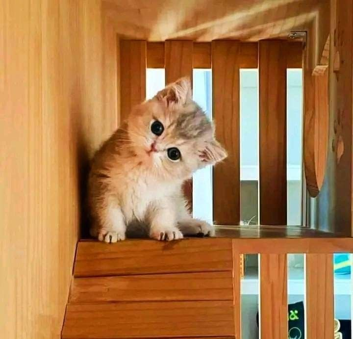

# Parallel-programming-2026
Прикладное программирование. Лабораторные работы

Выполнил студент группы 6211-100503D
Васильченко Данила Александрович - 1 подгруппа

- [**Первая лабораторная работа**](lab1)
  - 🐍 [Основной код](lab1/lab1.cpp)
  - 🧪 [Проверка через питон](lab1/check.py)
  - 🔢 [Выведенная матрица](lab1/endfile.txt)
  - 🔢 [Отчёт по лабе](lab1/README.md)
- **Вторая лабораторная работа**
  - 🐍 [Основной код](lab3/lab3.cpp)
  - 🧪 [Проверка через питон](lab3/check.py)
  - 🔢 [Отчёт по лабе](lab3/README.md)
- **Третья лабораторная работа**
  - 🐍 [Основной код](lab3/lab3.cpp)
  - 🧪 [Проверка через питон](lab3check.py)
  - 🔢 [Отчёт по лабе](lab3/README.md)
- **Четвёртая лабораторная работа**
  - 🐍 Основной код

