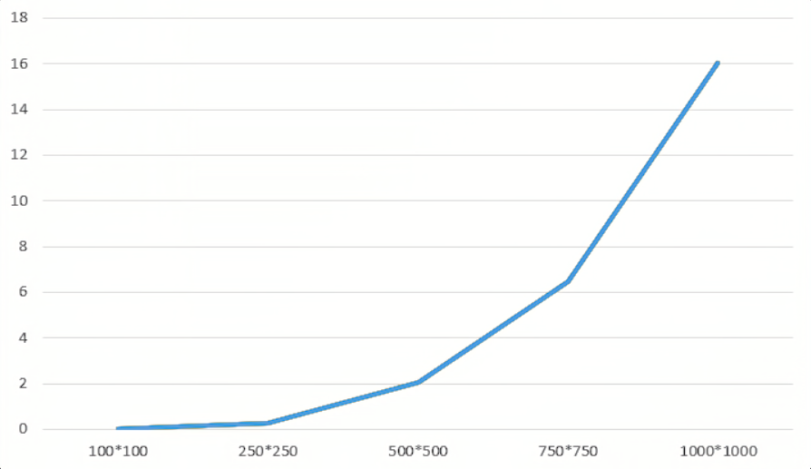
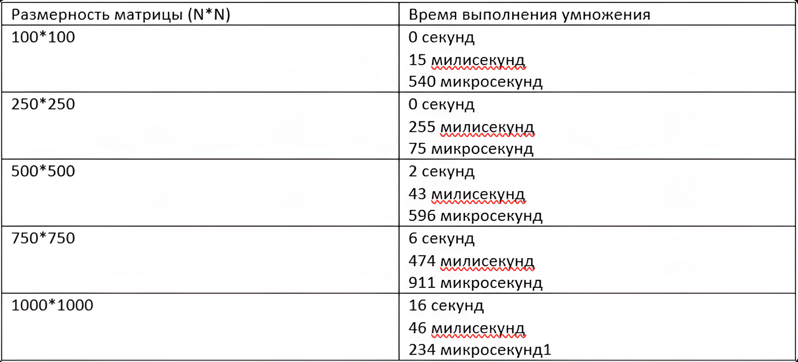

# Отчет по лабораторной работе №1

**Цель работы:**
- Разработка программы на языке C++ для перемножения двух квадратных матриц с чтением исходных данных из файлов, записью результата в файл, замером времени выполнения и автоматизированной верификацией результатов с помощью стороннего ПО (Python/NumPy).

**Реализация программы:**
- Генерация данных (create_matrix) – создает файл с квадратной матрицей заданного размера, заполненную случайными числами от 1 до 100. 
- Чтение из файла (read_matrix) – считывает матрицу из текстового файла. 
- Алгоритм умножения (multiplication) – реализует классический алгоритм умножения матриц. 
- Запись результатов (write_in_file) – сохраняет результирующую матрицу в выходной файл и выводит временные характеристики в консоль. 
- Верификация – после завершения вычислений программа автоматически запускает Python-скрипт check.py, который сравнивает результат программы с результатом NumPy.

**Результаты вычислений:** 
- Процессор: Ryzen 5 5500U (6 ядер, 12 потоков) 
- ОЗУ: 16 GB
- На картинке 1 представлены результаты замеров времени выполнения программы в зависимости от размера матрицы. На картинке 2 представлен график зависимости времени выполнения умножения матриц от их размерности.

